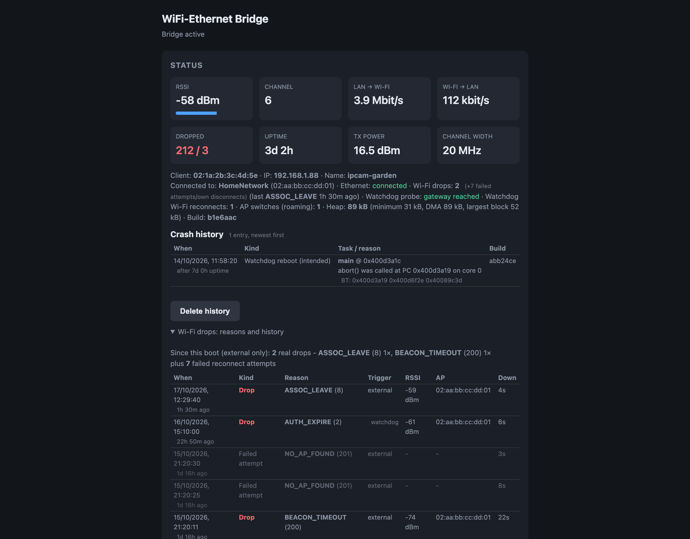
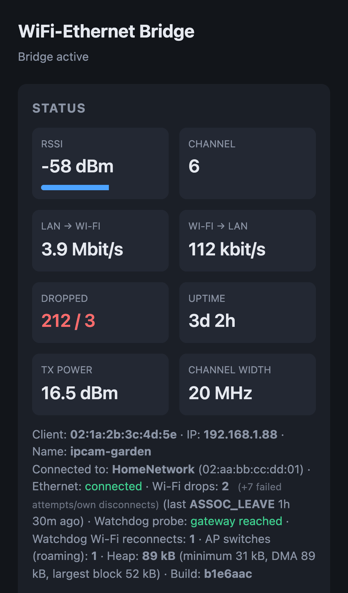
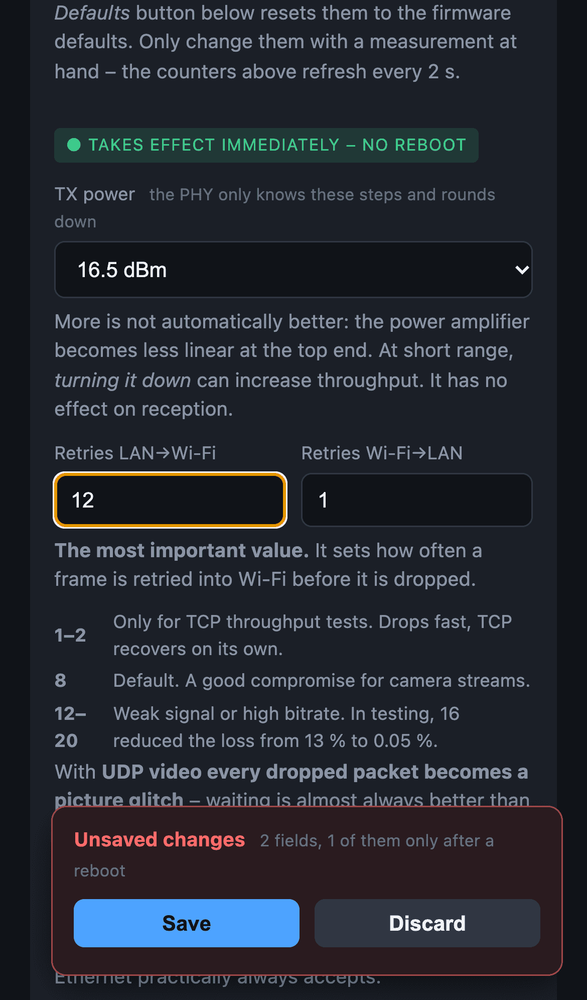

# ESP32 Wi-Fi Bridge on Steroids

A **transparent Layer-2 Wi-Fi ↔ Ethernet bridge** for the WT32-ETH01 — and, as a second target, an ESP32-C5 with a W5500 SPI Ethernet module (dual-band 2.4/5 GHz) — with a web portal, a JSON API, MQTT telemetry with Home Assistant autodiscovery, over-the-air updates, a self-healing watchdog, crash forensics and live performance tuning.

Plug an IP camera (or any Ethernet device) into the board, and it appears on your Wi-Fi network **as if it were cabled directly to your router** — same MAC, its own DHCP lease, directly reachable, discovery protocols intact. No NAT, no second subnet, no port forwarding.

Written in C++ against plain ESP-IDF (PlatformIO, no Arduino). Derived from [owenthewizard/esp32-wifi-bridge](https://github.com/owenthewizard/esp32-wifi-bridge) (Rust), which contributed the core idea and the driver tuning this project started from.

<p align="center">
  
  &nbsp;
  
</p>

---

## Contents

- [How it works](#how-it-works)
- [Why not one of the existing solutions?](#why-not-one-of-the-existing-solutions)
- [Features](#features)
- [The web portal](#the-web-portal)
- [HTTP API](#http-api)
- [MQTT and Home Assistant](#mqtt-and-home-assistant)
- [Hardware](#hardware)
- [Building and flashing](#building-and-flashing)
- [Onboarding](#onboarding)
- [Performance](#performance)
- [Troubleshooting](#troubleshooting)
- [Project layout](#project-layout)
- [Credits and license](#credits)

---

## How it works

### MAC cloning instead of 4-address mode

An 802.11 station operates in *3-address mode*: the access point delivers frames only to the MAC address that associated with it. A normal bridge would need 4-address mode (WDS), which almost no consumer AP offers. This project sidesteps that entirely — it **sniffs the MAC address of the device on the Ethernet port and clones it onto the Wi-Fi interface**. From the network's point of view there is no bridge at all; there is just your camera, on Wi-Fi.

### One interface, one MAC, two IP addresses

The bridge stays manageable while doing this. `esp_wifi_internal_reg_rxcb()` has exactly one callback slot, normally owned by lwIP. This firmware takes it over and acts as the doorman itself:

```
                      ┌──────────────── ESP32 ────────────────┐
 Ethernet client ───► │ eth_rx_cb ──► esp_wifi_internal_tx ───┼──► Wi-Fi / AP
 (camera, MAC X)      │     │ dst = mgmt IP?                  │
                      │     └──► lwIP (portal, API, MQTT)     │
 Ethernet client ◄─── │ esp_eth_transmit ◄── wifi_rx_cb ◄─────┼─── Wi-Fi / AP
                      │                          │ dst = mgmt IP?
                      │      lwIP ◄──────────────┘            │
                      └───────────────────────────────────────┘
```

- **Ethernet → Wi-Fi** (`eth_rx_cb`): every frame goes straight to `esp_wifi_internal_tx()` on the STA interface, with a configurable number of retries when the Wi-Fi TX buffer is full.
- **Wi-Fi → Ethernet** (`wifi_rx_cb`): `is_for_mgmt()` inspects the raw frame — IPv4 destination or ARP target equal to the management IP — and hands only those frames to lwIP via `esp_netif_receive()`. Everything else goes straight to `esp_eth_transmit()`.
- Broadcast/multicast IPv4 is deliberately *not* treated as management traffic; it only goes to the bridged client. The hot path stays free of special cases.
- Both callbacks run from IRAM, and each frees its buffer exactly once on every path — the ownership contract that keeps the data path leak- and use-after-free-free. `CONFIG_LWIP_L2_TO_L3_COPY` is required (and enforced with an `#error`) because the Ethernet path frees its buffer right after handing a management frame to lwIP.

The Wi-Fi STA and the management netif share the cloned MAC but have different IPs; ARP resolves both to the same MAC, which switches and APs do not mind at all. **The management IP must be static** — DHCP would hand the same MAC two leases.

### Boot sequence

1. Load the configuration from NVS. Decide the mode: **provisioning** (no credentials, factory-reset pin held, previous bridge start failed, or three unstable boots in a row) or **bridge**.
2. Bridge mode: start Ethernet, wait for the first frame of the client to learn its MAC (or fall back to the MAC stored from an earlier boot), switch the EMAC to promiscuous mode.
3. Start Wi-Fi with the cloned MAC and scan once: try the configured SSIDs that are actually visible in their configured priority first, then the unseen ones (a hidden SSID does not show up in a scan), each with several attempts, always picking the strongest AP of that SSID. An absent network 1 therefore costs no timeouts at boot, and the priority order stays meaningful when it returns.
4. Detect the location by pinging each profile's gateway, apply that profile's static IP.
5. Arm the data path, start the HTTP server, MQTT, SNTP and the NetBIOS responder.
6. After 30 s of network reachability, confirm the OTA image so it is not rolled back; after 60 s, mark the boot as stable. In portal mode with stored credentials a new image is *not* confirmed — the portal then means the new firmware could not get onto the network, and the portal idle reboot rolls back to the previous one.

---

## Why not one of the existing solutions?

### NAT-based ESP32 "repeaters" / `esp32_nat_router` and friends

By far the most common approach, and the reason people end up disappointed. The wired device lands **behind NAT on its own subnet**:

- It is **not reachable from your LAN** unless you set up port forwarding, per port, per device.
- **mDNS / SSDP / ONVIF WS-Discovery do not cross the NAT boundary.** Your NVR will not find the camera. Frigate, Home Assistant, Synology Surveillance Station — all of them discover cameras by broadcast or multicast.
- The device gets a fake DHCP lease from the ESP32, not from your router. No DHCP reservations, no name in your router's device list, no consistent addressing.

This project has **no NAT and no second subnet**. The camera gets a real lease from your real DHCP server and answers ARP on your real LAN.

### OpenWrt client mode + `relayd`

Works, but `relayd` is a proxy-ARP pseudo-bridge, not true L2 forwarding. It handles IPv4 well and everything else poorly (IPv6, non-IP protocols, some multicast). You also need a device running OpenWrt: more cost, more power draw, more to configure.

### WDS / 4-address mode

The technically correct answer, and unavailable in practice. Consumer APs — FRITZ!Box, most mesh systems, ISP routers — do not expose it, or only between units of the same brand.

### Commercial Wi-Fi client bridges (Vonets, TP-Link in client mode, …)

These do essentially the same MAC-cloning trick, and they work. What you don't get: any insight into what is happening. No packet counters, no loss rate, no disconnect reasons, no MQTT, no OTA, closed firmware, and no way to tune the radio when the link misbehaves.

### The Rust original this project came from

[owenthewizard/esp32-wifi-bridge](https://github.com/owenthewizard/esp32-wifi-bridge) implements the same core idea cleanly and compactly, and its Wi-Fi and Ethernet buffer configuration is the basis for this one. What it deliberately does not have is everything around the data path: no configuration interface, no telemetry, no updates without a cable, no diagnostics. Credentials are compiled in.

**If you want a minimal, elegant bridge and you are comfortable reflashing over USB to change an SSID, use the original.** This project exists for the case where the board ends up somewhere you cannot easily reach.

---

## Features

### Bridging

- **Transparent L2 forwarding** in both directions, raw frames, no IP stack in the path.
- **MAC cloning** with automatic sniffing of the attached device, plus persistence — a camera only talks when *it* boots, so the learned MAC is stored in NVS and reused if the bridge restarts on its own. A different device plugged in is detected within a 30 s window at boot.
- **Promiscuous Ethernet mode**, so unicast traffic to the client is forwarded, not just broadcast.
- **Smart retry strategy** in the Ethernet → Wi-Fi path: the first retries only yield the CPU (`taskYIELD()`) instead of sleeping a full tick, because the Ethernet DMA only buffers a few milliseconds at 100 Mbit/s.
- Hot-path callbacks in IRAM; no flash cache miss per forwarded packet.

### Management

- **Static management IP on the same interface**, selectively delivered to lwIP. The bridge is reachable while bridging.
- **Self-contained web portal** — status, configuration, tuning, diagnostics, firmware upload. A single embedded page (~40 KB), no external assets, no internet required. Works on desktop and phone.
- **Provisioning mode**: with no credentials stored, the board opens an access point `<name>-setup-XXXX` (password `bridgesetup`) and serves the same portal at `192.168.4.1`.
- **JSON API** — everything the portal does is scriptable. See [HTTP API](#http-api).
- **NetBIOS name announcement** (`WIFIBRIDGE-<last octet of client IP>`), so the bridge shows up by name instead of "unknown" in routers that learn names via NBNS (e.g. FRITZ!Box).

### Multi-site operation

- **Three network profiles**, each with its own SSID, password, IP, netmask and gateway. Empty mask/gateway fields fall back to profile 1, so a half-filled profile never leaves the board unreachable.
- **Network failover and failback**: if the connected network disappears at runtime, the bridge switches to the next configured network after the same time a boot spends on one network (connect timeout × attempts, default 60 s), round-robin. While on a lower-priority network it checks every 5 min with a targeted scan whether a higher-priority one is back (≥ −80 dBm) and returns to it; a failback that does not connect doubles that interval (up to 1 h). Every switch is logged with the trigger `failover` and re-runs the location detection.
- **Automatic location detection**: after associating, the bridge pings each configured profile's gateway and adopts the one that answers. This works even when several sites use the *same SSID* — a case where selecting by SSID alone cannot work.
- **Strongest-AP selection** (`WIFI_ALL_CHANNEL_SCAN` + `WIFI_CONNECT_AP_BY_SIGNAL`). In a mesh with several nodes sharing an SSID, the ESP-IDF default (`WIFI_FAST_SCAN`) picks whichever it finds first and never re-evaluates.
- **Connect retries per SSID** (default 3 × 20 s): a quick reboot can find the AP still holding the old session of the cloned MAC, so a single attempt is not enough.

### Active roaming

ESP-IDF picks the strongest AP once and then stays on it forever. With roaming enabled (portal switch, default off), the bridge checks every `roam_check_s` (default 300 s) — **but only while its own RSSI is below the threshold** (default −70 dBm), so a good link never wastes airtime on scans. If another AP of the same SSID is better by at least `roam_margin_db` (default 6 dB), it disconnects and reconnects to the strongest one. The AP it is currently on never counts as a candidate, so measurement noise cannot cause ping-pong.

### Self-healing watchdog

Detects a bridge the driver still reports as "connected" but that has stopped delivering — something RSSI and `wifi_up` cannot show.

- **Evaluated in 20 s windows.** With enough traffic (≥ 200 packets) the loss ratio decides (≥ 15 % = bad). With too little traffic, the bridge actively **pings its gateway** through the management netif — the same lwIP/radio path the portal uses. ≥ 4 reconnects in a window are bad regardless.
- **Escalates by symptom, cheapest fix first**, after `wd_bad_windows` bad windows in a row (default 3):
  1. Ethernet link up, gateway reachable, but the client has gone silent → **restart only the Ethernet driver** (a real link down/up for the camera, Wi-Fi untouched).
  2. Any Wi-Fi-side symptom, or the Ethernet reset did not help → **disconnect and reconnect Wi-Fi** (Ethernet untouched).
  3. Still bad → **reboot via `abort()`**, not `esp_restart()`, so a core dump is written and the next boot is diagnosable.
- **Selectable escalation levels** (`wd_actions`): e.g. "Ethernet reset only" for a setup where Wi-Fi must never be touched. Disabled levels are skipped; the highest allowed level is repeated if the problem persists.
- Watchdog reboots **never count as failed boots** for the boot-loop protection.
- Counters `wd_reconnects`, `wd_eth_resets` and the RTC-persisted `wd_last_reason` are visible in the portal, the API and MQTT; every escalation step also publishes an immediate MQTT event.
- A manual **Restart Ethernet** button (`POST /api/eth_reset`) works independently of the watchdog.

### Updates and recovery

- **OTA over HTTP** with automatic rollback. A new image boots as `PENDING_VERIFY` and only confirms itself after **30 s of network reachability** — not merely "it booted". Anything that does not confirm is undone by a single power cycle.
- **Boot-loop protection**: three starts without 60 s of stable operation, and the board falls back to the portal instead of rebooting forever.
- **Portal idle auto-recovery**: while in the setup AP with no real portal use (page load, save, scan — deliberately *not* the 2 s status poll), the board retries a normal boot with the stored credentials every `ap_idle_reboot_s` (default 15 min). Only if credentials exist, so a factory-reset board does not loop.
- **Factory reset** by holding GPIO14 (ESP32-C5 target: GPIO4) low for two seconds at boot.
- **Fast start**: the AP of the last successful connection is kept in NVS and tried directly at boot, without a scan; only if it does not answer is the regular scan run. On the ESP32-C5 target the data path is up about 4 s after power-on instead of ~19 s.

### Crash forensics

- **Core dumps** to a dedicated 64 KB flash partition, retrievable over HTTP (`/api/coredump`: panic reason, task, PC, backtrace).
- **Timestamped crash history** (`/api/crashes`, last 8 entries in NVS): every unexpected reset — panic, interrupt/task/hardware watchdog, brownout — is recorded on the next boot with its **wall-clock time** (SNTP, gateway first, `pool.ntp.org` as fallback), the uptime it crashed at and the build it was running. A heartbeat in RTC memory, updated every second, survives the crash and tells the next boot when it happened. A stale core dump (panic without a new image) is detected by its CRC fingerprint and not attributed to the wrong crash.
- **Previous boot's log**: the console output lives in a ring buffer in RAM that survives every reset but a power loss; after a crash, watchdog or software reset the last 2 KB of the previous boot are stored in NVS together with the reset reason (`/api/log?prev=1`, *Previous boot* in the portal).
- **Build identification**: every build embeds its git revision (`"build"` in `/api/status`), and `scripts/ota_flash.sh` archives the matching `firmware.elf` so a later core dump can be resolved with `addr2line` against the exact binary.

### Console log over the network

The serial console is unreachable on a deployed board (and on the ESP32-C5's native USB it only shows output while a host has the port open). Everything printed to `stdout` — the firmware's own log lines and `ESP_LOG` output — is also kept in an 8 KB ring buffer and shown in the portal's *Console log* box, polled once a second while it is open (`GET /api/log`, admin key). ROM and bootloader output is not captured.

### Dual-band Wi-Fi (ESP32-C5 target)

`wifi_band` selects which band the bridge may use: **prefer 5 GHz** (default — a 5 GHz AP is chosen over 2.4 GHz as long as it is at least −75 dBm), **5 GHz only**, **2.4 GHz only**, or **strongest signal**. With 5 GHz preferred, a bridge that had to fall back to 2.4 GHz moves back to 5 GHz as soon as a usable 5 GHz AP shows up, even with roaming switched off. The connect is pinned to the BSSID and channel the scan picked. The setting is only offered in the portal on hardware that supports 5 GHz.

### Wi-Fi disconnect log

A plain counter does not say *why* the link dropped, and the serial log is not accessible on a deployed board. Every disconnect is recorded in a **48-entry ring buffer in RTC memory** (survives reboots and crashes) with reason, RSSI, AP, time and outage duration.

- **Real drops vs. failed attempts**: the driver reports a failed reconnect attempt with the same event as the loss of an existing connection. After one kick by the AP, a dozen failed attempts often follow; they are counted separately (`fails`) so they do not bury the actual cause (`kicks`).
- **Trigger attribution**: disconnects caused by the firmware itself (connect timeout, watchdog, roaming, restart) are marked as such and not counted as radio problems.
- Statistics per reason since boot, and the most recent real drop, in the portal, the API and MQTT.

### Telemetry and diagnostics

- **MQTT** with Home Assistant autodiscovery — see [MQTT and Home Assistant](#mqtt-and-home-assistant).
- **Client IP and hostname snooping** — the bridge reads the client's source address from IPv4/ARP frames and its hostname from DHCP option 12. Invaluable when a camera is "missing": you see immediately whether it has an address, which one, and whether it announces a name.
- **Actual values, not requested ones**: TX power and channel width are read back from the driver, because the PHY quantizes TX power to 11 discrete steps and HT40 is only ever a request.
- **Heap low-water mark, DMA-capable free memory and largest free block**, so memory pressure is visible before it becomes a crash.

### Tuning

| Setting | Takes effect | Default |
|---|---|---|
| TX power (2–20 dBm, 11 PHY steps) | immediately | PHY maximum |
| TX retries LAN→Wi-Fi / Wi-Fi→LAN | immediately | 8 / 1 |
| TX queue cap LAN→Wi-Fi (frames) | immediately | off |
| Watchdog on/off, allowed actions, bad windows | immediately | off, all, 3 |
| Roaming on/off, interval, threshold, margin | immediately | off, 300 s, −70 dBm, 6 dB |
| Portal idle reboot delay | immediately | 900 s |
| Wi-Fi static/dynamic RX, dynamic TX buffers | after reboot | 16 / 32 / 32 |
| RX block-ack window | after reboot | 32 |
| HT20 / HT40, 802.11b rates | after reboot | HT20, 11b on |
| Wi-Fi connect timeout / attempts per SSID | at next connect | 20 s / 3 |

All tuning fields follow one convention: **`0` stored = "use the firmware/sdkconfig default"**, so `sdkconfig.defaults` stays the single source of truth. The portal always shows the value actually in effect.

**Retry calibration (autotune)**: measures the loss rate under real traffic for ~19 s per step, starting at the current value. If that misses the 0.10 % target it goes up while each step brings clearly less loss, then down as long as the loss stays within bounds, and picks the **smallest** value that meets the target — not the best one, because every retry blocks the Ethernet receive task a little longer. A collapse guard aborts a step within seconds if the packet rate drops below 30 % of the reference, and the run aborts honestly if there is not enough traffic to measure.

**TX power calibration**: measures the PHY's power steps from 13 to 20 dBm against the live stream with the same timing and collapse guard. Per step it records the loss (frames without a TX buffer plus frames the MAC abandoned on the air) and the **queue delay** — how long a frame waited in the driver's TX queue, from the TX-done accounting below. It starts at the current value, tries every higher step, then lower ones until one leaves the tolerance, and saves the **highest** power that is as good as the best measurement: power is only reduced where more of it measurably hurts, because link margin is what carries the stream through interference a short measurement never sees. Steps the driver maps to the same actual power are measured once, and the smallest request that reaches it is saved — the ESP32 tested here caps at 14.75 dBm whatever is requested above 15 dBm. Results per step are shown in the portal and at `GET /api/autotune`.

**TX queue cap and its calibration**: with a cap of N, a LAN→Wi-Fi frame larger than 256 bytes is dropped at once when N frames already wait for the air, instead of occupying one of the TX buffers; small frames (TCP ACKs, ARP, ping) always pass. There is deliberately no waiting at the cap — a frame held back in the Ethernet receive task only moves the same backlog into the DMA ring. The cap bounds the queue delay and the heap the queue uses, at the cost of loss in bursts. The calibration measures without a cap first, then caps 24/16/12/8, stops at the first that loses noticeably more than the reference or delivers under 90 % of its throughput, and saves the smallest passing cap — or off. On the camera link it was developed on, even cap 24 lost 0.30 % (vs. 0.00 %) while halving the queue wait, so the result was off: for a TCP video stream, the tail of an I-frame is better off waiting in the queue than being retransmitted.

**Long-run retry check**: short windows cannot separate retry values that both stay below 0.10 % loss — on the development link the 15-second calibration picks 8 retries, while hours of operation showed 12 to lose five times less (0.012 % vs 0.063 %). The long-run check settles that under real operation: one step below the current value, the value itself and two steps above take turns in 5-minute blocks (10 s settle each) for 2–24 h, so every candidate sees the same mix of busy and quiet hours. The smallest value whose loss is at most 1.5× the best one (+50 ppm) is saved; a candidate needs 50,000 packets to count, and one losing more than 1 % leaves the rotation at once. A reboot ends it without a result.

**Calibrate all** runs the retry, TX power and queue cap calibrations in that order, each measuring with the previous results applied (~3–5 min), and by default appends the 6-hour long-run retry check. It stops when a stage has too little traffic, a manual save overrides it, or *Stop* is pressed (which restores the saved values). Every calibration measures the LAN→Wi-Fi direction under the traffic flowing *at that moment* — run it while the client does its real job; a synthetic load such as `iperf3` tunes for bulk transfer, not for a game or a call.

**TX queue and air loss**: a TX-done callback (`esp_wifi_set_tx_done_cb`) reports every frame the Wi-Fi MAC finished, delivered or abandoned after its hardware retries. Frames handed to the driver minus frames finished is the TX queue depth; averaged per completion and divided by the frame rate (Little's law) it gives the time a frame waits for the air. That is the bufferbloat behind high and jittery ping times on a busy channel, and it rises long before frames get lost. The callback reports the encrypted 802.11 frame, so the management stack's few frames cannot be filtered out; the estimate resynchronizes instead whenever it would go negative or the link has been idle for a second.

---

## The web portal

One page, four cards: **Status** (live tiles refreshed every 2 s, client and link details, crash history, Wi-Fi drop log), **Configuration** (device name, three network profiles, MQTT, admin key), **Tuning** (live and reboot-required settings, calibration, watchdog, roaming) and **Firmware update**.

<p align="center">
  
</p>

- The fields show the values **currently in effect**; *Defaults* fills in the firmware defaults without saving.
- An **unsaved-changes notice** tracks every edited field, says how many of them need a reboot, and offers *Save* / *Discard*. After saving it offers the reboot if one is needed. Leaving the page with unsaved changes asks first.
- **Reboot buttons trigger on release**: pressing turns them red ("Release = reboot"), dragging away or scrolling cancels — an accidental tap on a phone reboots nothing. After a reboot the page reloads by itself as soon as the bridge answers again.
- Password fields are never sent back by the board; leaving one empty means "unchanged".
- SSIDs from scans are inserted via the DOM, never as HTML, so a neighbor's AP named `` cannot run script in the portal.

Full-page screenshots: [desktop](images/desktop-full.png) · [iPhone](images/iphone-full.png)

---

## HTTP API

All endpoints are served on the management IP (or `192.168.4.1` in provisioning mode) over plain HTTP. Responses are JSON with `Cache-Control: no-store`.

**Authentication:** if an admin key is set, the endpoints marked 🔑 require the header `X-Admin-Key: <key>`. Without a key everything is open. Note that `/api/config` (including changing the admin key) and `/api/reboot` are **not** protected — keep the management IP on a trusted network.

| Method | Path | Description |
|---|---|---|
| GET | `/` | The portal page |
| GET | `/api/status` | Live counters, link state, calibration progress, heap, build |
| GET | `/api/config` | Current configuration, defaults and running buffer values (never passwords) |
| POST | `/api/config` | Save configuration (`application/x-www-form-urlencoded`) |
| POST | `/api/reboot` | Reboot |
| POST | `/api/eth_reset` | Restart the Ethernet driver (link down/up for the client) |
| POST | `/api/autotune` | Start the retry calibration; `?kind=txp` the TX power, `?kind=cap` the queue cap calibration, `?kind=long&h=N` the N-hour long-run retry check (default 6), `?kind=all&h=N` all three in sequence plus an N-hour long-run check (`h=0`: none); `?kind=stop` aborts whatever runs and restores the saved values |
| GET | `/api/autotune` | Per-step results of all calibrations: `{"retries":[{"k","loss"}],"txp":[{"k","act","loss","delay"}],"cap":[{"k","loss","delay","kbps"}],"long":[{"k","pkts","drops","bad"}]}` (loss in 1/100 %, -1 = collapse; delay in 0.1 ms; powers in 0.25 dBm; cap 0 = off) |
| GET | `/api/scan` | Scan for Wi-Fi networks |
| GET | `/api/disconnects` | Wi-Fi disconnect statistics and log |
| POST 🔑 | `/api/update` | Upload firmware (raw `.bin` body) |
| GET / DELETE 🔑 | `/api/coredump` | Read / erase the stored core dump |
| GET / DELETE 🔑 | `/api/crashes` | Read / clear the crash history |
| GET 🔑 | `/api/log?since=N` | Console output from byte position `N` (max 2 KB per reply; `X-Log-Next` = position for the next poll, `X-Log-Reset: 1` after a reboot or ring wrap) |
| GET 🔑 | `/api/cpu` | CPU share per task over the last and the busiest 5 s window, with the bridge throughput in each (`?reset=1` forgets the busiest). Needs `CONFIG_FREERTOS_GENERATE_RUN_TIME_STATS` (on for the ESP32-C5 target), else `{"enabled":0}` |
| GET / POST 🔑 | `/api/speed` | `GET ?mb=N` sends N MiB of zeros, `POST` discards the body and reports `bytes`/`ms`/`kbps`: a throughput test of the management stack. With the default 2880-byte lwIP TCP windows it tops out around 5 Mbit/s - it measures the bridge's own Wi-Fi only with larger windows |
| GET 🔑 | `/api/log?prev=1` | End of the previous boot's console output; `X-Log-Rst` = the reset reason that ended it |

### `GET /api/status`

```json
{"prov":0,"wifi":1,"eth":1,"rssi":-58,"ch":6,
 "kbps_up":3870,"kbps_down":112,"pkt_up":1843210,"pkt_down":912455,"drop_up":212,"drop_down":3,
 "wifi_disc":9,"wifi_kicks":2,"disc_r":8,"disc_rs":"ASSOC_LEAVE","disc_src":0,"disc_ago":5420,
 "wd_probe":1,"wd_reconnects":1,"wd_eth_resets":0,"wd_last_reason":0,"roam_count":1,
 "uptime":266400,"client_mac":"02:1a:2b:3c:4d:5e","client_ip":"192.168.1.88","client_name":"ipcam",
 "ssid":"HomeNetwork","bssid":"02:aa:bb:cc:dd:01",
 "at":0,"at_s":0,"at_n":10,"at_r":0,"at_k":8,
 "heap":91172,"heap_min":32064,"heap_dma":91172,"heap_blk":53248,
 "txp":59,"bw":20,"air_ok":1842977,"air_fail":0,"cc":"01","cc_max":20,
 "txq":0,"txq_x10":27,"txq_ms":21,"pt":2,"pt_s":3,"pt_k":52,"pt_r":60,
 "drop_cap":0,"txq_cap":0,"qc":2,"qc_s":2,"qc_k":24,"qc_r":0,"all":5,
 "lr":1,"lr_k":12,"lr_el":5,"lr_tot":360,"lr_r":0,
 "time":1792236053,"build":"b1e6aac"}
```

| Field | Meaning |
|---|---|
| `prov` | 1 = provisioning mode (setup AP), 0 = bridge mode |
| `wifi`, `eth` | Wi-Fi associated / Ethernet link up |
| `rssi`, `ch`, `ssid`, `bssid` | Current AP |
| `kbps_up`, `kbps_down` | Throughput LAN→Wi-Fi / Wi-Fi→LAN in kbit/s (1 s average) |
| `pkt_*`, `drop_*` | Forwarded and dropped packets since boot, per direction |
| `wifi_disc` | All disconnect events since boot (incl. failed attempts and own disconnects) |
| `wifi_kicks` | Real drops of an existing connection, externally caused |
| `disc_r`, `disc_rs`, `disc_src`, `disc_ago` | Last real drop: reason code and name, trigger (0 external, 1 connect, 2 watchdog, 3 roaming, 4 restart, 5 failover), seconds ago |
| `net`, `fo` | Configured network slot in use (1–3), network switches (failover/failback) since boot |
| `wd_probe` | Last watchdog gateway probe: 0 not needed/off, 1 ok, 2 failed |
| `wd_reconnects`, `wd_eth_resets` | Watchdog actions since boot |
| `wd_last_reason` | Reason of the last watchdog reboot (survives the reboot): 0 none, 1 loss ratio, 2 reconnects, 3 gateway probe, 4 no client traffic |
| `roam_count` | Active AP switches since boot |
| `client_mac`, `client_ip`, `client_name` | Bridged client (IP and DHCP host name snooped from its traffic; `-` = unknown) |
| `at`, `at_s`, `at_n`, `at_r`, `at_k` | Calibration: state (0 idle, 1 running, 2 done, 3 too little traffic), completed steps, candidate count, result, value under test |
| `heap`, `heap_min`, `heap_dma`, `heap_blk` | Free heap, minimum since boot, free DMA-capable internal memory, largest free block (bytes) |
| `txp` | Actual TX power from the driver, in 0.25 dBm units |
| `bw` | Negotiated channel width in MHz |
| `air_ok`, `air_fail` | Frames the Wi-Fi MAC delivered / abandoned after its hardware retries since boot (lost on the air, unlike `drop_up`) |
| `cc`, `cc_max` | Regulatory country in effect (adopted from the AP by default) and its TX power cap in dBm |
| `txq`, `txq_x10`, `txq_ms` | Frames waiting in the driver's TX queue now, their mean over the last second ×10, and the resulting mean wait per frame in ms |
| `pt`, `pt_s`, `pt_k`, `pt_r` | TX power calibration: state (as `at`), completed measurements, power under test and chosen power (0.25 dBm units) |
| `drop_cap`, `txq_cap` | Frames dropped by the TX queue cap since boot (also counted in `drop_up`), cap in effect (0 = off) |
| `qc`, `qc_s`, `qc_k`, `qc_r` | Queue cap calibration: state (as `at`), completed measurements, cap under test, chosen cap (0 = off, -1 = no result) |
| `all` | *Calibrate all*: 0 idle, 1–4 running stage (retries, TX power, queue cap, long-run check), 5 done, 6 stopped |
| `lr`, `lr_k`, `lr_el`, `lr_tot`, `lr_r` | Long-run retry check: state (as `at`), retries in the running block, minutes elapsed / total, chosen retries |
| `spi` | W5500 SPI clock in MHz (ESP32-C5 target), 0 = internal EMAC |
| `w5` | W5500 driver counters since boot: drops `[TX ring full, SEND timeout, RX resync, RX no heap,` then RX rounds that found only an incomplete frame (not a drop)`]` (all 0 with the internal EMAC) |
| `rst`, `rtc` | Reset reason of this boot (`esp_reset_reason_t`), and whether RTC memory survived it (1) |
| `time` | UTC Unix time, 0 = not synced via SNTP yet |
| `build` | Git revision of the running firmware (`-dirty` if built from uncommitted changes) |

### `GET /api/config` / `POST /api/config`

`GET` returns every field below plus `"def"` (firmware defaults, used by the *Defaults* button) and `"eff"` (buffer values currently running, which can differ from saved ones until the next reboot). Passwords are never returned.

`POST` takes a form-urlencoded body. Fields that are missing stay unchanged; **empty password fields mean "unchanged"**; empty IP fields of profiles 2/3 clear them. Values are clamped to safe ranges so a typo cannot make a remote board unusable. `0` means "firmware default" for all tuning fields.

| Field | Range / meaning |
|---|---|
| `name` | Device name (MQTT, Home Assistant, setup AP, NetBIOS) |
| `ssid1..3`, `pass1..3` | Wi-Fi networks, tried in order |
| `ip`, `mask`, `gw` | Profile 1 static management IP (required) |
| `ip2..3`, `mask2..3`, `gw2..3` | Profiles 2/3, optional |
| `mqtt_host`, `mqtt_port`, `mqtt_user`, `mqtt_pass` | Broker (empty host = MQTT off) |
| `telemetry_s` | MQTT publish interval, 1–3600 s |
| `admin_pass` | Admin key for the 🔑 endpoints |
| `tx_power` | 0 or 8–84 (0.25 dBm units) |
| `eth_tx_retries`, `wifi_tx_retries` | 0–20 |
| `static_rx_buf` | 0 or 2–32 |
| `dynamic_rx_buf`, `dynamic_tx_buf` | 0–128 |
| `rx_ba_win` | 0–32 |
| `ht40`, `no_11b` | 0/1 |
| `wifi_connect_timeout_s` | 0 or 3–60 |
| `wifi_connect_retries` | 0–10 |
| `wd_enable` | 0/1 |
| `wd_actions` | Bit mask: 1 Ethernet reset, 2 Wi-Fi reconnect, 4 reboot (0 = all) |
| `wd_bad_windows` | 0–30 |
| `ap_idle_reboot_s` | 0 or 60–65535 |
| `roam_enable` | 0/1 |
| `roam_check_s` | 0 or 30–65535 |
| `roam_rssi_threshold` | 0 or −100…−1 dBm |
| `roam_margin_db` | 0–40 |
| `txq_cap` | 0 (off) or 4–64 frames |
| `wifi_band` | 0 prefer 5 GHz, 1 5 GHz only, 2 2.4 GHz only, 3 strongest signal (ESP32-C5 target; `band5g` in `GET` says whether the hardware has 5 GHz) |

Saving applies TX power and retries immediately; watchdog and roaming settings are read live; everything else takes effect after a reboot.

```bash
# Raise the LAN→Wi-Fi retries to 12 without rebooting
curl -X POST -d 'eth_tx_retries=12' http://<mgmt-ip>/api/config
```

### `GET /api/disconnects`

```json
{"kicks":2,"fails":7,"rest":0,
 "by_reason":[{"r":8,"rs":"ASSOC_LEAVE","n":1},{"r":200,"rs":"BEACON_TIMEOUT","n":1}],
 "log":[{"prev":0,"t":260980,"e":1792230633,"ago":5420,"r":8,"rs":"ASSOC_LEAVE",
         "src":0,"up":1,"rssi":-59,"bssid":"02:aa:bb:cc:dd:01","down":4}]}
```

`kicks` / `fails`: real drops and failed attempts since this boot (external only); `by_reason`: real drops per `wifi_err_reason_t`; `rest`: drops whose reason did not fit the table. Each log entry: `prev` (boots ago, 0 = current), `t` (uptime at the drop), `e` (UTC time, 0 = unknown), `ago` (seconds ago, current boot only), `r`/`rs` (reason), `src` (trigger, see above), `up` (1 = real drop, 0 = failed attempt), `rssi`, `bssid`, `down` (seconds until reconnected, −1 = not reconnected).

### `POST /api/update` 🔑

Streams the raw body into the inactive OTA slot. The first byte is checked against the ESP image magic before anything is written, so an accidental upload of the wrong file cannot brick the board. Forwarding is paused during the flash write; the management connection stays up.

```bash
curl -X POST --data-binary @.pio/build/wt32-eth01/firmware.bin \
     -H 'X-Admin-Key: <key>' http://<mgmt-ip>/api/update
```

Prefer `scripts/ota_flash.sh <ip> [admin-key]`, which also archives the matching `firmware.elf`.

### `GET /api/coredump` 🔑 · `GET /api/crashes` 🔑

```json
{"present":true,"readable":true,"corrupted":false,"task":"main","pc":"0x400d3a1c",
 "reason":"abort() was called at PC 0x400d3a19 on core 0","bt":["0x400d3a19","0x400d6f2e"]}
```

```json
{"now":1792236053,"recs":[{"e":1792169553,"up":604800,"rst":4,"f":3,"build":"abb24ce",
  "task":"main","pc":"400d3a1c","reason":"abort() was called ...","bt":["400d3a19"]}]}
```

Crash records: `e` crash time (UTC, 0 = unknown), `up` uptime at the crash (−1 = unknown), `rst` `esp_reset_reason_t` (255 = imported from before the history existed), `f` flags (1 core dump data valid, 2 intended watchdog reboot, 4 imported, 8 backtrace incomplete, 16 panic without a new dump). `DELETE` on either endpoint erases it.

### `GET /api/scan`

`[{"ssid":"HomeNetwork","rssi":-58}, …]` — up to 20 networks, hidden ones skipped. Blocks for a few seconds while scanning.

---

## MQTT and Home Assistant

Enabled when a broker host is set. Plain MQTT (no TLS, deliberately — it would cost ~40 KB of flash for a device that talks to a broker on the local network). `<node>` is the last three bytes of the (cloned) STA MAC in hex.

| Topic | Content |
|---|---|
| `bridge/<node>/state` | JSON state every `telemetry_s` seconds |
| `bridge/<node>/availability` | `online` / `offline` (retained, last will) |
| `bridge/<node>/watchdog` | Immediate event per watchdog action: `{"action":"eth_reset\|wifi_reconnect\|reboot","reason":"loss\|disconnects\|probe\|eth_stall","uptime":…}` |
| `homeassistant/sensor/bridge_<node>/…/config` | Retained autodiscovery entries |

State payload fields: `rssi`, `ch`, `kbps_up`, `kbps_down`, `pkt_up`, `pkt_down`, `drop_up`, `drop_down`, `wifi_disc`, `wifi_kicks`, `disc_reason`, `wd_reconnects`, `wd_eth_resets`, `roam_count`, `eth`, `uptime`, `heap`, `bssid`, `client_ip`, `txq_ms`, `air_fail`.

Home Assistant creates one device with sensors for signal strength, Wi-Fi channel, throughput both ways, dropped packets both ways, uptime, free heap, client IP, watchdog reconnects and Ethernet resets, active AP switches, Wi-Fi disconnects total, Wi-Fi drops and last drop reason, TX queue delay and frames lost on air, plus an **Ethernet link** connectivity binary sensor. The watchdog events show up in the history with Home Assistant's own receive timestamp.

---

## Hardware

- **WT32-ETH01** (ESP32-D0WD + LAN8720A PHY, RMII with external 50 MHz clock). No PSRAM, and none is needed — Wi-Fi DMA buffers must live in internal RAM anyway.
- **8 MB flash** on the board used for development. The partition table (`partitions_8mb_ota.csv`) gives two 3 MB OTA slots plus a 64 KB core dump partition; ~1.8 MB stay unallocated as a reserve because a partition table cannot be changed over the air. The firmware uses ~30 % of a slot.
- **A proper 5 V supply at the 5V pin.** Not USB, and *not a power bank*. Two failure modes look exactly like firmware bugs:
  - Fed from a USB-serial adapter's 5 V pin, the rail collapses when Wi-Fi starts and takes the adapter down with it. Tell-tale: the *adapter* re-enumerates on USB — a crashing ESP32 cannot do that.
  - A power bank switches off because the ESP32 in download mode draws less than its idle threshold. Symptom: `esptool` fails with "No serial data received", identical to a broken TX wire.

### Second target: ESP32-C5 + W5500

- **NiceMCU ESP32-C5_MINI_V1.0** (ESP32-C5HF4: single-core RISC-V at 240 MHz, dual-band Wi-Fi 6, 4 MB in-package flash, no PSRAM, native USB) plus a **W5500** module (W5500-Lite) on SPI. PlatformIO environment `nicemcu-c5-w5500`; partition table `partitions_4mb_ota.csv` (2 × 1920 KB OTA + 64 KB core dump), firmware ~58 % of a slot.

| W5500 | ESP32-C5 |
|---|---|
| SCLK | IO9 |
| MOSI | IO8 |
| MISO | IO2 |
| CS | IO10 |
| INT | IO15 (required) |
| RST | IO3 |

- **SPI clock:** 80 MHz is the W5500's theoretical maximum (33.3 MHz guaranteed). With SCLK/MOSI routed through the GPIO matrix (these are not the SPI2 IO_MUX pins) the MISO data arrives too late for plain 80 MHz, so the firmware first tries **80 MHz in half-duplex mode with read compensation** (one dummy clock before every read), then plain 80 → 53.3 → 40 → 20 MHz, keeping the first setting at which the chip identifies itself. The reference wiring runs at **80 MHz** compensated (`spi` in `/api/status`). The check only catches gross failures — marginal wiring would show up as RX resyncs (`w5[2]`) or TCP retransmissions.
- **INT is on IO15, not IO12** (UART0 RX) as a precaution: the W5500 keeps running through a reset and holds INT low, and the ROM's download mode also listens on UART0 RX. This is *not* why the automatic reset into download mode over USB fails (see below) — that happens with INT on IO15 as well.
- **Own W5500 MAC driver** (`src/w5500_mac.c`) instead of ESP-IDF's: transmit only queues the frame (packed 32 KB ring, large enough for a whole Wi-Fi A-MPDU burst), the next frame is written to the chip while the previous one is still on the wire, received frames are fetched several per SPI transfer, and large transfers run interrupt-driven so the single core stays free for Wi-Fi. About 4 SPI transactions per frame instead of ~10. IDF's driver is still used for the W5500's PHY.
- **Factory reset is GPIO4**, not the BOOT button (IO28): held at reset, BOOT enters download mode.
- **Console and flashing over the USB-C port** (USB-Serial/JTAG, `/dev/cu.usbmodem*`). On macOS the port only delivers output while the host asserts DTR. esptool's automatic reset into download mode does not work on this board: it fails with "No serial data received" and leaves the board hung until it is power-cycled. Flash the first time with BOOT held while plugging in USB, then use OTA.

### Wiring for flashing

| USB-serial adapter | WT32-ETH01 |
|---|---|
| TX | RX0 (crossed) |
| RX | TX0 (crossed) |
| GND | GND |
| DTR / RTS | IO0 / EN (optional, for automatic reset) |

For the WT32-ETH01: use a **3.3 V logic** adapter. Pull **IO0 to GND** to enter download mode; the firmware only runs with it removed. Leave **IO14 unconnected** — it is the factory-reset input. Never open the serial monitor while an OTA is in progress: toggling DTR/RTS resets the board.

---

## Building and flashing

A PlatformIO project using `framework = espidf` (no Arduino).

```bash
git clone https://github.com/doctormord/ESP32-Wifi-Bridge-on-Steroids.git
cd ESP32-Wifi-Bridge-on-Steroids
pio run -e wt32-eth01                                            # build
pio run -e wt32-eth01 -t upload --upload-port /dev/ttyUSB0       # first flash via serial
scripts/ota_flash.sh <mgmt-ip> [admin-key]                       # later: build + archive ELF + OTA

# ESP32-C5 + W5500
pio run -e nicemcu-c5-w5500
pio run -e nicemcu-c5-w5500 -t upload --upload-port /dev/cu.usbmodem1101
scripts/ota_flash.sh <mgmt-ip> "<admin-key>" nicemcu-c5-w5500
```

C5-only settings (W5500 driver, USB console, 4 MB flash, coredump stack) live in `sdkconfig.defaults.esp32c5`, which ESP-IDF applies on top of `sdkconfig.defaults` for that target.

Always pass `--upload-port` explicitly if more than one serial adapter is attached.

### PlatformIO needs Python 3.10 – 3.13

The `platform-espressif32` package rejects Python ≥ 3.14. If your system Python is newer (Homebrew's `platformio` uses `python@3.14` and rebuilds its own venv on every run), create a standalone environment:

```bash
python3.13 -m venv ~/.pio-py313
~/.pio-py313/bin/pip install "platformio==6.1.19" pyyaml
~/.pio-py313/bin/pio run -e wt32-eth01
```

`pyyaml` is not a PlatformIO dependency, but the platform's `component_manager.py` imports it.

### Things that bite

- **Flash size is configured in two places.** `board_build.flash_size` sets what ESP-IDF believes; `board_upload.flash_size` sets the size nibble esptool writes into the image header. Both must match the board. A header claiming *more* than the chip has makes `esp_flash_init_default_chip()` fail hard — the board never boots.
- **`sdkconfig.<env>` is a generated cache.** ESP-IDF only fills in options *missing* from it, so a stale value silently wins over a change in `sdkconfig.defaults`. Delete it and let it regenerate rather than hand-editing.
- **Configuration layout is append-only.** `BridgeConfig` is stored as one magic-prefixed NVS blob; `cfg_load()` accepts shorter blobs from older firmware, so new fields must be **appended only**, and resizing an existing field requires a factory reset.

---

## Onboarding

1. **Flash** the firmware, remove the IO0 jumper, power-cycle.
2. **Connect an Ethernet device** — the bridge waits for its first frame to learn the MAC. A laptop is ideal for the first run: it speaks DHCP and ARP on its own, so success is visible in both directions immediately.
3. With no credentials stored, the board opens **`<name>-setup-XXXX`** (password `bridgesetup`). Join it and open **`http://192.168.4.1`**.
4. Enter Wi-Fi credentials and a **static management IP**.
   - It must be **outside your DHCP pool**. The bridge and the client share one MAC, so a DHCP server handing out that address would collide with the static one.
   - The **gateway field is your router**, not a second management address.
5. Optionally set an **admin key** to protect firmware updates and crash data.
6. *Save & reboot*. The board comes up in bridge mode and is reachable at the address you set.

### Consequences worth understanding

- Because the bridge and the client share a MAC address, your router shows **one device, not two**. Whatever name or DHCP reservation you attach to that MAC applies to both. Tell them apart by IP.
- **The management IP is reachable from the Wi-Fi side only.** Ingress from the Ethernet side works, but replies cannot get back: lwIP's egress always goes out over Wi-Fi, and the AP will not relay a frame back to the station it came from. Reach the portal from the LAN, not from a laptop behind the bridge.

---

## Performance

Measured on the WT32-ETH01 development board with an IP camera streaming:

| | |
|---|---|
| Peak throughput | **21.2 Mbit/s** (over a mesh AP at −61 dBm) |
| Loss at peak | **0.003 %** |
| Sustained camera stream (~10 Mbit/s) | **0.005 %** loss over an hour |
| Latency through the bridge | **4.9 ms** average |

In a direct A/B against the Rust original on the same board and spot, both landed around 60 Mbit/s combined (24/36 and 29/31). Radio environment dominates: the same firmware delivered 3.3 Mbit/s upstream on a weak mesh node and 35.7 Mbit/s on a good access point. **Placement beats tuning.**

### ESP32-C5 + W5500

Measured LAN → Wi-Fi with four parallel HTTP downloads from a bridged IP camera to a Wi-Fi client, 15 s, 5 GHz channel 40 at −66 dBm, SPI at 53 MHz:

| W5500 MAC driver | 4 streams | 1 stream |
|---|---|---|
| ESP-IDF's | 11.6 Mbit/s | 9.0 Mbit/s |
| own (`w5500_mac.c`) | **14.4–14.8 Mbit/s** | 9.8 Mbit/s |

The single stream is limited by the camera's web server. Later, with the RX stall fix and the packed TX ring, 8 streams sustained 18.9 Mbit/s over 60 s without a single drop. A speed test from a laptop behind the bridge: ~17.5 down / ~13 up Mbit/s, against 48/31 for the laptop's own Wi-Fi at the same spot.

The radio link is not what limits it: placed 1 m from the AP (−17 dBm) the bridge was exactly as fast as at −55 dBm. The SPI path is — with the clock raised from 53 to 80 MHz (half-duplex read compensation, see the hardware section) the same test went from 17.4 / 18.6 to **20.0 / 22.1 Mbit/s** (4 / 8 streams), every download byte-identical, no RX resyncs, the SPI bus then busy 46 % of the time instead of 64 %. CPU is ~60 % idle throughout. On 2.4 GHz the bridge got a 7 dB stronger signal (about the free-space difference between the bands) but less throughput (14–15 Mbit/s, busier band) — keep it on 5 GHz. Expect less than the WT32-ETH01's internal EMAC: every frame crosses the SPI bus, and Wi-Fi, the W5500 task and lwIP share one CPU core.

### Retry counts matter more than anything else

| Retries | Loss (UDP camera stream) |
|---|---|
| 1 | 13.29 % |
| 4 | 0.426 % |
| 8 | 0.059 % |
| 16 | **0.000 %** |

For **TCP**, dropping fast is better — the protocol retransmits and backs off, and blocking the receive task only causes bursty loss in the Ethernet DMA. For **UDP video**, every dropped packet is a permanent artefact. The default is 8; use the calibration to find the right value for your link. More is not free: each retry holds the `emac_rx` task longer, and what arrives meanwhile is lost in the DMA where no counter sees it.

### More Wi-Fi buffers make things worse

Raising `dynamic_tx_buf` from 32 to 64 dropped free heap from 111 kB to 9 kB and halved the download, because TX and RX buffers compete for the same memory. The defaults (16/32/32, BA window 32) come from the upstream project.

---

## Troubleshooting

**Board unreachable after a config change.** Power-cycle, or wait: an unconfirmed firmware is rolled back; a bridge that could not associate restarts into the portal; three unstable starts also land in the portal — and with credentials stored it retries on its own after `ap_idle_reboot_s`.

**Bridge works, portal does not.** You are probably reaching it from the Ethernet side. Use the Wi-Fi side.

**Frequent Wi-Fi drops.** Open *Wi-Fi drops: reasons and history* in the portal. `BEACON_TIMEOUT` points at the radio link; `ASSOC_LEAVE`, `AUTH_EXPIRE` or `ASSOC_TOOMANY` from an AP that otherwise sees good signal often mean AP-side band steering or load balancing kicking the bridge — check the AP's steering thresholds against the bridge's TX power.

**Throughput poor, RSSI good.** Check the retry count first, then which AP you are on (`/api/scan` shows what the board sees from where it is mounted).

**Unexpected reboot.** Check the crash history and `/api/coredump` before reflashing; resolve the backtrace with `xtensa-esp32-elf-addr2line -e elf_archive/<build>_*.elf <addresses>`. The ESP32-C5 (RISC-V) has no on-device backtrace; `/api/coredump` reports `pc`, the return address `ra` (as the only `bt` entry), `mcause` and `mtval` instead — resolve `pc` and `ra` with `riscv32-esp-elf-addr2line`. *Previous boot* in the console log box shows what the board printed right before.

**Board silent, adapter fine.** Power. See the hardware section.

---

## Project layout

```
src/
  main.cpp          entry point, boot modes, boot-loop protection, OTA confirmation, NetBIOS
  bridge.cpp/.h     data path, Ethernet/Wi-Fi setup, location detection, live tuning,
                    calibration, watchdog, roaming, disconnect log, statistics
  web.cpp/.h        portal page (PAGE[]) and JSON API, OTA upload
  config.cpp/.h     NVS-backed configuration (append-only blob)
  telemetry.cpp/.h  MQTT and Home Assistant discovery
  crashlog.cpp/.h   timestamped crash history, RTC heartbeat, SNTP
  conlog.cpp/.h     console ring buffer for /api/log, previous boot's log
  w5500_mac.c/.h    W5500 MAC driver (ESP32-C5 target), w5500_regs.h its registers
  compat.h          millis()/delay() over esp_timer/vTaskDelay
scripts/
  ota_flash.sh        build, archive firmware.elf, OTA-upload
  gen_build_info.py   pre-build hook, writes the git revision into src/build_info.h
  portal_screenshots.mjs  renders images/ from PAGE[] with anonymized sample data
images/             portal screenshots (32-color PNGs)
partitions_8mb_ota.csv   live partition table (2 × 3 MB OTA + 64 KB core dump)
partitions_4mb_ota.csv   ESP32-C5 target (2 × 1920 KB OTA + 64 KB core dump)
sdkconfig.defaults       single source of truth for driver and buffer settings
sdkconfig.defaults.esp32c5  ESP32-C5 additions (W5500, USB console, 4 MB flash)
docs/content/       development history, backlog, handoff notes
```

---

## Credits

This project stands on [owenthewizard/esp32-wifi-bridge](https://github.com/owenthewizard/esp32-wifi-bridge) by Owen Walpole, which established the approach and whose Wi-Fi and Ethernet buffer configuration this one still uses. Where the two were measured against each other on identical hardware, they performed the same — the differences here are in what surrounds the data path, not in the bridging itself.

Thanks also to [esp-rs](https://github.com/esp-rs/) and [Espressif](https://www.espressif.com/).

## License

GNU General Public License v3.0 or later, following the upstream project.

This program is distributed in the hope that it will be useful, but WITHOUT ANY WARRANTY; without even the implied warranty of MERCHANTABILITY or FITNESS FOR A PARTICULAR PURPOSE. See the GNU General Public License for more details.
